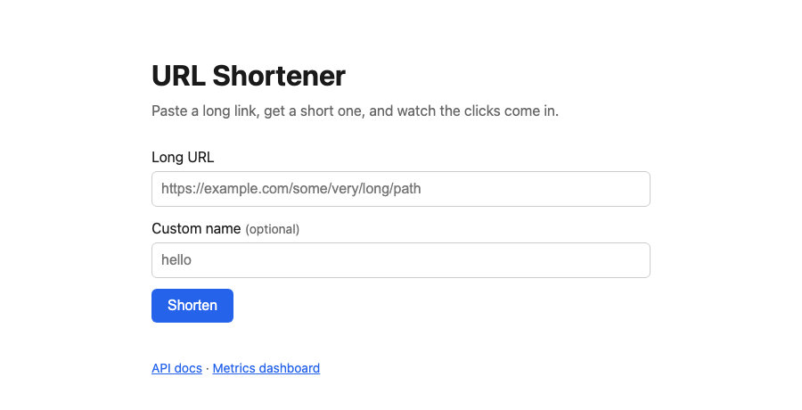
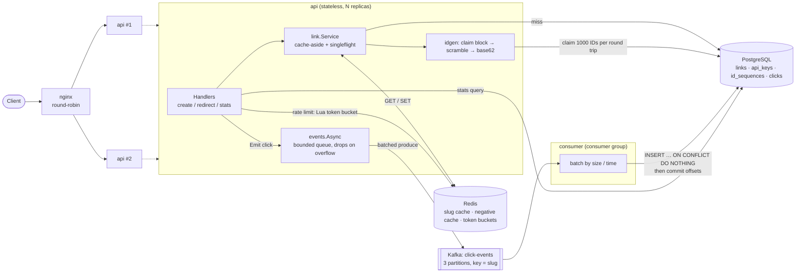

# Distributed URL Shortener

A read-optimized URL shortener in Go, built to demonstrate distributed-systems
design: stateless horizontally-scaled API, cache-aside reads, range-allocated
IDs, and an asynchronous, idempotent analytics pipeline over Kafka (or SQS).

Redirects outnumber writes ~100:1, so every decision below favors the redirect path.

## Demo UI

Open http://localhost:8080 after starting the stack: shorten a link, open it, and refresh to see the click count.



The REST API is documented as interactive Swagger UI at `/docs` (rendered from `api/openapi.yaml`).

## Architecture



More detail: [docs/ARCHITECTURE.md](docs/ARCHITECTURE.md)


## What's here

| Layer | Where | Verified how |
|---|---|---|
| Core service (API, consumer, Postgres, Redis, Kafka) | `cmd/`, `internal/`, `docker-compose.yml` | unit + integration tests, `scripts/smoke.sh` |
| Observability (Prometheus, Grafana, alert rules) | `internal/metrics`, `deploy/prometheus`, `deploy/grafana` | live scrape of all targets, dashboard provisioned |
| Load testing (k6, 100:1 mix) | `loadtest/`, [docs/LOADTEST.md](docs/LOADTEST.md) | run locally; numbers and caveats recorded |
| SQS backend (`EVENT_BACKEND=sqs`) | `internal/events/sqs`, `internal/consumer/sqs.go`, `docker-compose.sqs.yml` | unit tests + full smoke test on ElasticMQ |
| Kubernetes on kind | `deploy/k8s/` | deployed, smoke-tested, rolling restart under traffic |
| CI/CD (GitHub Actions) | `.github/workflows/` | runs on every push (see Actions tab); actionlint-clean |
| AWS via Terraform (ECS Fargate, RDS, ElastiCache, SQS, ALB) | `infra/terraform/` | `fmt`, `validate`, Trivy; **not applied to a real account** |

## Quick start

Requires Docker (and Go 1.27+ only if you want to run tests locally).

```bash
docker compose up --build -d     # postgres, redis, kafka, migrations, 2× api, consumer, nginx
./scripts/smoke.sh               # end-to-end check (create, redirect, stats, rate limit)
```

- **Demo UI: http://localhost:8080** (paste a URL, get a short link, watch the click count)
- API docs (Swagger UI): http://localhost:8080/docs
- Demo API key: `dev-key-change-me` (set `SEED_API_KEY` to change it)

```bash
curl -X POST localhost:8080/v1/links -H 'X-API-Key: dev-key-change-me' \
  -H 'Content-Type: application/json' \
  -d '{"url":"https://example.com/very/long/path","alias":"hello","expires_at":"2030-01-01T00:00:00Z"}'

curl -i localhost:8080/hello                      # 302 → destination
curl localhost:8080/v1/links/hello/stats -H 'X-API-Key: dev-key-change-me'
```

- Grafana (dashboard "URL Shortener Overview"): http://localhost:3000 (`GRAFANA_PORT` to change) · Prometheus: http://localhost:9090
- `docker compose -f docker-compose.yml -f docker-compose.sqs.yml up --build -d` runs the same stack with **SQS** (ElasticMQ) instead of Kafka
- `make loadtest` generates a 100:1 read-heavy workload with k6 while you watch Grafana
- `make k8s-up` deploys everything to a local **kind** cluster (API on :8081, Grafana on :3300)

Tear down with `docker compose down -v`.

### Tests

```bash
make test               # unit tests, race detector, no infrastructure needed
make test-integration   # + real Postgres and Kafka (see Makefile for the two docker run lines)
```

Unit tests cover code generation (base62, scrambler, allocator), the redirect path
(cache hit/miss/negative/expiry, Redis failure fallback, stampede coalescing, HTTP
status/headers/click emission), the rate limiter, and the consumer's commit-after-write
and redelivery behavior. Integration tests (build tag `integration`) cover concurrent
block claims against real Postgres, idempotent batch inserts, stats queries, and a Kafka round trip.

## Path and purpose

| Path | Purpose |
|---|---|
| `cmd/api/` | API process: wires config, Postgres, Redis, event publisher and HTTP server |
| `cmd/consumer/` | Click-event consumer process (Kafka or SQS) |
| `internal/httpapi/` | HTTP handlers, routing, response helpers, middleware |
| `internal/link/` | Link service: cache-aside reads, singleflight coalescing, negative caching, expiry |
| `internal/idgen/` | Block allocator, Feistel scramble, base62 encoding |
| `internal/cache/` | Redis client for slug and negative caches |
| `internal/ratelimit/` | Redis token bucket implemented in Lua |
| `internal/auth/` | API-key hashing and lookup |
| `internal/events/` | `Publisher` interface, bounded async queue, Kafka and SQS backends |
| `internal/consumer/` | Batching consumer with commit-after-write, Kafka and SQS variants |
| `internal/analytics/` | Click stats queries |
| `internal/store/postgres/` | Postgres access with explicit SQL (`pgx`, no ORM) |
| `internal/metrics/` | Prometheus metrics and observers |
| `internal/config/` | Environment-driven configuration |
| `api/` | Hand-written OpenAPI spec, embedded in the binary |
| `migrations/` | SQL schema migrations |
| `deploy/` | Dockerfiles, nginx, Prometheus rules, Grafana dashboard, kustomize manifests, kind scripts, ElasticMQ |
| `infra/terraform/` | AWS stack: ECS Fargate, RDS, ElastiCache, SQS, ALB |
| `loadtest/`, `scripts/` | k6 workload and smoke scripts |
| `docs/` | Architecture and load-test write-ups |

## Design patterns

- **Cache-aside with request coalescing.** Redirects read Redis first, fall back to Postgres, cache misses as negative entries,
  and `singleflight` collapses concurrent misses for one slug into one query.
- **Range allocation.** Each instance claims a block of 1000 IDs in one atomic update and hands them out from memory.
- **Keyed permutation for opaque codes.** A Feistel scramble plus base62 makes sequential IDs unguessable and collision-free.
- **Fire-and-forget with a bounded queue.** Click emission is a non-blocking send; overflow is dropped and counted rather than
  slowing the redirect.
- **Interface-backed messaging.** `events` hides Kafka versus SQS behind one interface, selected by `EVENT_BACKEND`.
- **At-least-once delivery plus idempotent sink.** The consumer commits offsets only after an `INSERT ... ON CONFLICT DO NOTHING`
  succeeds, so redelivery is harmless.
- **Token bucket in Lua.** Rate-limit checks are atomic in Redis.
- **Stateless replicas behind a load balancer.** All state is in Redis, Postgres and the queue, so the API scales horizontally.
- **Observer-style metrics.** Core code reports to observer interfaces, and the Prometheus implementation sits at the edge.

## Design decisions

The full reasoning, including rejected alternatives and accepted trade-offs, is in
[docs/DESIGN_DECISIONS.md](docs/DESIGN_DECISIONS.md). Summary:

| # | Decision | Choice | Why |
|---|---|---|---|
| 1 | Short codes | Block-allocated IDs → Feistel scramble → base62 | One DB write per 1000 links, collision-free, not guessable |
| 2 | Reads | Redis cache-aside + negative cache + singleflight | Redis outage or hot-key expiry degrades latency, not availability |
| 3 | Redirect status | 302, not 301 | A 301 is cached, so clicks would never reach us to be counted |
| 4 | Click events | Non-blocking bounded queue → Kafka, drop on overflow | Analytics can never slow or break a redirect |
| 5 | Consumer | At-least-once + idempotent `ON CONFLICT DO NOTHING` | Crash-safe without Kafka transactions |
| 6 | Queue backend | Kafka or SQS behind an interface | Same code runs locally and on AWS |
| 7 | Rate limiting | Redis token bucket in Lua | Atomic across replicas, immune to clock skew |
| 8 | API keys | SHA-256 hashes in Postgres | High-entropy keys don't need a slow hash |
| 9 | Source of truth | Postgres | Trivial KV access behind a cache, plus transactions for ID blocks |
| 10 | Smaller choices | stdlib `net/http`, `pgx`, `kafka-go`, hand-written OpenAPI | Fewer dependencies, explicit SQL |
| 11 | Observability | Prometheus pull, low-cardinality labels, 8 alerts | Redirect behavior is visible without per-request logs |
| 12 | Kubernetes | Plain kustomize, graceful rolling updates | Zero-downtime restarts, no Helm needed |
| 13 | CI/CD | GitHub Actions with real Postgres/Kafka and e2e jobs | The first real run caught a bug local runs hid |
| 14 | AWS | ECS Fargate + Terraform (not applied to a real account) | No node management for two stateless services |

## Failure behavior

| Failure | Behavior |
|---|---|
| Redis down | Redirects served from Postgres (slower); rate limiter fails open |
| Kafka down | Redirects unaffected; click events dropped/failed and counted (data loss for that window) |
| Postgres down | Cached redirects still work until TTL; creates, cache misses, stats fail; consumer retries with backoff, commits nothing |
| API instance crash | Unused IDs in its block are skipped; queued, unsent clicks are lost |
| Consumer crash | Uncommitted events re-delivered; idempotent insert prevents double count |

## Known limitations

- Click loss is possible on a bus outage or abrupt API crash (by design, see [decision 4](docs/DESIGN_DECISIONS.md#4-click-events-fire-and-forget-into-a-bounded-queue-then-kafka)). Observed during an outage test.
- Compose and kind run a single Kafka broker, Postgres and Redis: no replication. The AWS Terraform has Multi-AZ options but defaults to single instances for cost.
- Poison messages are skipped, not dead-lettered (SQS has a DLQ for delivery failures, but undecodable bodies are still skipped by the consumer).
- No link update/delete (would require cache invalidation).
- Swagger UI loads its assets from a CDN, so `/docs` needs internet access.
- `clicks` is a single table; it will need time partitioning at high volume.
- The load-test numbers come from one laptop running everything; see [docs/LOADTEST.md](docs/LOADTEST.md) for what they do and do not show.
- The AWS Terraform has been validated and security-scanned but never applied (no AWS account was used).
- Kubernetes secrets in git are demo values; use a secret manager for anything real.

## Configuration

Environment variables, with defaults suitable for compose (`internal/config`):
`DATABASE_URL`, `REDIS_ADDR`, `KAFKA_BROKERS`, `KAFKA_TOPIC`, `KAFKA_PARTITIONS`, `KAFKA_GROUP`,
`BASE_URL`, `HTTP_ADDR`, `BLOCK_SIZE`, `SCRAMBLE_SECRET`, `CACHE_TTL`, `NEGATIVE_CACHE_TTL`,
`RATE_LIMIT_BURST`, `RATE_LIMIT_PER_MINUTE`, `CONSUMER_BATCH_SIZE`, `CONSUMER_FLUSH_EVERY`,
`SEED_API_KEY`, `TRUST_PROXY`, `METRICS_ADDR`, `EVENT_BACKEND` (`kafka`|`sqs`), `SQS_QUEUE_URL`, `SQS_ENDPOINT`,
`AWS_REGION`, `REDIS_TLS`. Compose-only: `GRAFANA_PORT`, `RATE_LIMIT_*` (overridden by `make loadtest`).
